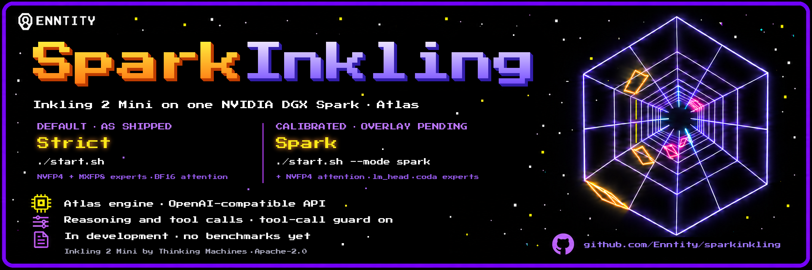

<!-- SPDX-License-Identifier: AGPL-3.0-only -->
<p align="center">
  
</p>

# SparkInkling

**SparkInkling 0.4.2.** Run `./start.sh --version` for this checkout, or
`./start.sh status` for the version and image of a running server.

Thinking Machines' [Inkling 2 Mini](https://huggingface.co/thinkingmachines/Inkling-2-Mini)
on one NVIDIA DGX Spark, served by the [Atlas](https://github.com/Atlas-Inf/atlas)
engine with an OpenAI-compatible API, image input, reasoning and tool calls.

0.4.2 drafts faster and exactly: a verify stops where the drafter is unsure,
Strict drafts for two requests at once, and greedy text with drafts matched
text without them in our checks. Against 0.4.1, Strict code is 20% faster and
structured output 16%, Spark code 13%. Tool calls now stream only for a
request that asks (`stream_tool_arguments: true`); every other request's calls
are held until the tool guard passes them. 0.4.1 added image input, an end to
Inkling's reasoning loops and resuming a rebuilt conversation from the prefix
cache. Spark is ahead of vLLM's own Inkling 2 Mini image with its DSpark
drafter on code, prose, prefill and one to four requests and level on
structured output, and Strict, the checkpoint as shipped, is ahead of vLLM
without speculation on code, structured output, prefill and one or two
requests and within 1-2% of it on prose and four to eight requests. See
[Performance](#performance); every result has its receipts under
[`results/`](results/).

## The model

Inkling 2 Mini (Apache-2.0) is a looped mixture-of-experts transformer: 26.4B
parameters, 3.4B active, 24 decoder layers whose middle 12 run three times per
token (48 layer visits), 128 experts with top-8 routing, hybrid sliding-window
and full attention without RoPE, text and image input, and up to 1M tokens of
context. Thinking Machines ships it as one ~20 GB checkpoint with NVFP4 and
MXFP8 experts and BF16 everything else, plus a bundled DSpark draft model.

SparkInkling serves text and images. Video is not supported.

## Strict and Spark modes

| | Strict (default) | Spark |
|---|---|---|
| Weights | The checkpoint as shipped: NVFP4 experts in layers 0-19, MXFP8 experts in 20-23, BF16 attention, router and vocabulary head | Strict plus a calibrated NVFP4 overlay for the attention projections, the vocabulary head and the experts of layers 20-23 |
| Start | `./start.sh` (or `--mode strict`) | `./start.sh --mode spark` |
| Extra download | none | [`Enntity/Inkling-2-Mini-Spark-NVFP4`](https://huggingface.co/Enntity/Inkling-2-Mini-Spark-NVFP4), 2.9 GB |
| Fidelity | the checkpoint's own numerics | KL 0.0081 to Strict's weights (97.0% top-1 agreement, 224 held-out documents) |

Spark reads about half the bytes a token reads in Strict. [The modes in
detail](docs/MODES.md).

## Performance

Measured on the 0.4.2 image with RigMark (reasoning low, temperature 0), one
Spark, the default profile and drafter, against vLLM's own Inkling 2 Mini image
on the same Spark: [the result, with every receipt](results/2026-11-23-release-0.4.2/RESULT.md).

| | Strict | Spark | vLLM | vLLM + DSpark |
|---|---:|---:|---:|---:|
| Code decode, tok/s | 65.2 | **77.5** | 35.1 | 69.8 |
| Prose decode | 35.3 | **55.7** | 35.6 | 31.2 |
| Structured decode | 92.6 | **103.6** | 35.6 | 104.3 |
| 32K cold prefill, tok/s | **3,274** | **3,277** | 2,722 | 2,723 |
| Short code, C1 / C2 / C4 / C8 aggregate | 41.3 / 63.1 / 85.0 / 120.7 | **53.9 / 77.7 / 105.8 / 135.4** | 35.1 / 54.0 / 86.6 / 122.4 | 43.4 / 60.9 / 94.7 / 144.0 |
| 32K prompt sent again, time to first token | 0.16 s | 0.16 s | | |
| Basic output gates | 6/6 | 6/6 | 6/6 | 6/6 |

Spark leads vLLM without speculation everywhere and vLLM with its drafter on
code, prose, prefill and one to four requests, is level with it on structured
output, and trails it at eight requests. Strict reads the checkpoint's BF16
attention weights as shipped, about twice the bytes a Spark token reads.
SparkInkling drafts for one or two live requests and decodes plainly from
three ([issue 1](https://github.com/Enntity/sparkinkling/issues/1)); vLLM's
drafter also runs under load.
Prefix caching costs a cold prompt of 512 tokens or more one short extra pass
(about 0.1 s: about 2% at 32K and 5-6% at 8K against 0.3.0), which is what lets the
next turn resume. The vLLM receipts were measured the day before.

## Quick start

```sh
git clone https://github.com/Enntity/sparkinkling.git
cd sparkinkling
cp .env.example .env      # optional: every setting has a default
./start.sh
```

## Requirements

- One DGX Spark (GB10, 128 GB unified memory) with Docker and the NVIDIA
  runtime.
- About 25 GB free for the checkpoint, plus 2.9 GB for Spark mode's overlay.
- The default profile takes 0.80 of GPU memory; leave the rest for the host
  and anything else it runs.

## What `./start.sh` does

Each step is skipped when already done, so rerunning it just restarts the
engine.

1. **Image.** Pulls `ghcr.io/enntity/atlas-sparkinkling:<tag>`, where the tag
   is the git tree of [`install/`](install/), so the image always matches your
   checkout. If that tag is not published, it builds the image
   from source ([`install/build.sh`](install/build.sh): Atlas at the commit
   and tree pinned in [`install/atlas-source.json`](install/atlas-source.json),
   for the `inkling-2-mini` kernel target; 30-60 minutes cold).
2. **Weights.** Downloads
   [`thinkingmachines/Inkling-2-Mini`](https://huggingface.co/thinkingmachines/Inkling-2-Mini)
   at revision `ed40e7da625f` (pinned in
   [`install/checkpoint.json`](install/checkpoint.json)) and checks its weight
   and tokenizer files' sha256, then assembles the DSpark drafter's directory
   next to it ([`install/dspark_drafter.py`](install/dspark_drafter.py)). In
   Spark mode it also downloads and checks the overlay, then assembles the
   Spark model directory ([`install/spark_overlay.py`](install/spark_overlay.py)).
   It uses `hf` when installed and a throwaway container otherwise.
3. **Serve.** Starts the container, waits for health, then answers one
   smoke-test question.

Other commands: `./start.sh stop | status | logs | build | download`.

## Use it

The API listens on `http://127.0.0.1:8895/v1`, model `inkling-2-mini-atlas`,
with no authentication. Put your own authenticated proxy in front of it
before exposing it.

```sh
curl -s http://127.0.0.1:8895/v1/chat/completions -H 'Content-Type: application/json' -d '{
  "model": "inkling-2-mini-atlas", "max_tokens": 1024, "reasoning_effort": "low",
  "messages": [{"role": "user", "content": "Write a haiku about one small computer."}]}'
```

**Images** go in as OpenAI `image_url` parts with a base64 `data:` URI (PNG,
JPEG, WebP, GIF, BMP, TIFF):

```sh
curl -s http://127.0.0.1:8895/v1/chat/completions -H 'Content-Type: application/json' -d '{
  "model": "inkling-2-mini-atlas", "max_tokens": 1024,
  "messages": [{"role": "user", "content": [
    {"type": "image_url", "image_url": {"url": "data:image/png;base64,'"$(base64 -w0 photo.png)"'"}},
    {"type": "text", "text": "What is in this picture?"}]}]}'
```

Inkling does not resize an image: each 40x40 pixel tile is one token, so a
1280x960 image is 768 tokens. An image of more than 1,600 tiles (about
1600x1600 pixels) is scaled down to fit, which the checkpoint's own processor
does not do. `http(s)` image URLs are refused unless the engine is started
with remote fetching allowed.

Reasoning comes back separately from the answer. `reasoning_effort` (`none`,
`minimal`, `low`, `medium`, `high`, `xhigh`) is passed to the model's own
template; a request that names none reasons at `low`. The template's own
default, `high`, often reasons in loops at temperature 0 (the model card warns
of it): on 150 MMLU-Pro questions with an 8,192-token cap, `high` scored 107
with 30 answers cut off, `medium` 120 with 8 and `low` 125 with 2. The model
always thinks a little, even at `none`, so leave room in `max_tokens`. Tool calls (OpenAI `tools`, streaming
included) are returned as OpenAI tool calls. The tool-call guard SparkQwen and
SparkGLM ship is on by default (`TOOL_GUARD` in `.env`), and holds each call
until its complete arguments pass. A request that sends
`stream_tool_arguments: true` gets its calls' arguments as they are written
instead; the guard then checks each call when it ends, and a call it blocks
finishes `content_filter`, not `tool_calls`, which such a client must not run
([docs/TOOL-GUARD.md](docs/TOOL-GUARD.md)).

**Settings** (`.env`, see [`.env.example`](.env.example)): `MODE`, `PROFILE`
(below), `DRAFTER`, `GPU_MEMORY_UTILIZATION` (0.50-0.90), `PREFIX_CACHE_DIR`
and `PREFIX_CACHE_GB` (below), `MODEL_ROOT`, `PULL=0`.

### Profiles

| `PROFILE` | Requests | Tokens each | GPU memory | KV pool | Prefix-cache snapshots |
|---|---:|---:|---:|---:|---:|
| `default` | 8 | 1,048,576 | 0.80 | about 2.0M tokens (1.86M Spark) | 264 |
| `max` | 32 | 1,048,576 | 0.85 | about 1.94M tokens (1.82M Spark) | 264 |
| `saver` | 8 | 786,432 | 0.50 | about 952K tokens (830K Spark) | 192 |

All three keep BF16 KV, 4,096-token prefill chunks, prefix caching,
hour-long requests and up to 32,768 generated tokens a tool-calling request
(the model reasons before it calls). Requests the pool cannot hold yet wait
for blocks rather than fail. KV costs about 32 KiB a token: the 40
sliding-window layer visits keep only their last 1,024 tokens
([ENGINE](docs/ENGINE.md)). `saver` is the smallest footprint, for a Spark
shared with other services. In a check on 2026-11-21, `max` ran 32
concurrent short code requests to a normal stop and recalled a code hidden a
third of the way into a 182,100-token prompt (82 s for the prompt;
[receipts](results/2026-11-21-prefix-cache-and-profiles/RESULT.md)). A JSON file
of your own works too (`PROFILE=/path/to/profile.json`, same schema as
[`install/profiles/`](install/profiles/)).

### Prefix caching

A request that repeats an earlier prompt's beginning (a chat's next turn, a
shared system prompt) skips prefilling what the cache still holds. Inkling's
short convolutions carry state from token to token, so the cache saves each
visit's state (about 4.8 MB a sequence, in host memory) every 4,096 tokens and
at the end of each prompt, and a hit resumes from the deepest one it matches.
On a 7.5K-token prompt the time to first token went from about 2.4 s cold to
0.12 s warm, with byte-identical answers.

Some clients rebuild their last few messages every turn (a voice agent's
context blocks after the history). Each such turn forks from the previous
prompt before its end, so the cache also saves a state where a prompt forks
from a cached one by 512 tokens or more, and the next turn resumes there. On a
replay of a voice call (16-17K-token prompts, three rebuilt trailing messages)
the time to first token of a new turn went from 1.3-1.7 s to 0.6-0.8 s (one
run on a development build).

### Prefix cache on disk

When the KV pool fills, the prefix cache drops the conversations used least
recently, and one that comes back is prefilled again from the start. With
`PREFIX_CACHE_DIR` set, the engine writes the KV blocks it drops to that disk
instead and reads them back when the conversation returns; the engine tier
and settings are SparkQwen's and SparkGLM's.

```sh
PREFIX_CACHE_DIR=/srv/sparkinkling/prefix-cache
PREFIX_CACHE_GB=48                            # GiB, 16-100 (default 48)
```

`start.sh` creates `<mode>/kv/` in the directory, refuses one on tmpfs or
without that much space free, and mounts it into the container. With the tier on, the engine keeps
full-length KV (192 KiB a token over all 48 layer visits; the window-bounded
pool needs one block id for every layer), so 48 GiB holds about 262K tokens
and the profile's pool falls back to 0.4.2's size: requests longer than that
pool cannot be admitted. In one check on 2026-11-21 (Strict, a pool
held to 5,373 blocks, ~20K-token conversations pushed out by five others), a
returning conversation's time to first token went from 5.82 s to 0.90 s: the
engine read its 1,237 blocks back in 403 ms and resumed from the snapshot at
token 19,776, and the answer was identical to a run with the tier off
([receipts](results/2026-11-21-prefix-cache-and-profiles/RESULT.md)).
The engine takes the tier's staging buffers and on-disk index out of the KV
pool (388 MiB at 16 GiB). The state snapshots a restore starts from stay in
host memory: a conversation
comes back from disk while its snapshot is still among the profile's
snapshots. Nothing is kept across a restart: the engine deletes its files as
soon as it has them open, and clears a crash's leftovers when it starts.

## Speculative decoding

Both modes run the checkpoint's bundled DSpark drafter by default
(`DRAFTER=dspark`): it proposes up to seven tokens a step and the mode's own
weights verify them, so it changes speed, not the model. Greedy text with the
drafter on matched text with it off in our check
([LIMITATIONS](docs/LIMITATIONS.md#fidelity)).

- **A verify stops where the drafter is unsure.** The drafter reports how
  confident it is in each draft, the engine learns while serving how often
  drafts at each confidence are accepted, and a step verifies only as far as
  the block is still likely right.
- **Drafts go off where they do not pay.** A request whose drafts stop being
  accepted decodes plainly for a short stretch (32 tokens at first, longer
  while re-probes keep failing), so code and structured output draft and
  prose mostly does not.
- **Concurrent requests.** Strict drafts for one or two live requests and
  decodes plainly, in a batch, from three; Spark drafts for one.

`DRAFTER=none` turns the drafter off.

## Reproduce our numbers

Every figure above has its commands, unedited receipts and checksums under
[`results/`](results/README.md). [docs/REPRODUCE.md](docs/REPRODUCE.md) is how
to run the same RigMark suites and the functional check on your own Spark.
What SparkInkling does not do, and what its evidence does not cover, is in
[docs/LIMITATIONS.md](docs/LIMITATIONS.md).

## Other ways to run it

**By hand:** every step of `./start.sh` as a separate command, in
[docs/INSTALL-MANUAL.md](docs/INSTALL-MANUAL.md).

**Versions:** how releases are numbered and identified, in
[docs/VERSIONING.md](docs/VERSIONING.md).

## The engine

SparkInkling builds Atlas from
[`Enntity/atlas`](https://github.com/Enntity/atlas)
`inkling2/swa-kv-window-20261124`, the Inkling 2 Mini serving series on
Atlas-Inf `main`, pinned by commit and tree in
[`install/atlas-source.json`](install/atlas-source.json). The first two parts
are in Atlas upstream
([Atlas-Inf/atlas 401](https://github.com/Atlas-Inf/atlas/pull/401) and
[404](https://github.com/Atlas-Inf/atlas/pull/404), merged 2026-11-23); the
rest is proposed as [405](https://github.com/Atlas-Inf/atlas/pull/405) and
[408](https://github.com/Atlas-Inf/atlas/pull/408).
What the branch adds and what it does not do yet:
[docs/ENGINE.md](docs/ENGINE.md).

## Credits

Inkling 2 Mini and its DSpark draft model are by Thinking Machines Lab
(Apache-2.0). Measurement uses [RigMark](https://github.com/alexellis/rigmark)
by Alex Ellis (MIT). The launcher and install directory are adapted from
[SparkQwen](https://github.com/Enntity/sparkqwen) and
[SparkGLM](https://github.com/Enntity/sparkglm).

## License

AGPL-3.0-only ([LICENSE](LICENSE)); third-party components keep their own
licenses ([NOTICE](NOTICE), [docs/LICENSING.md](docs/LICENSING.md)). The model weights are not distributed here; check
the checkpoint's model card before downloading.
